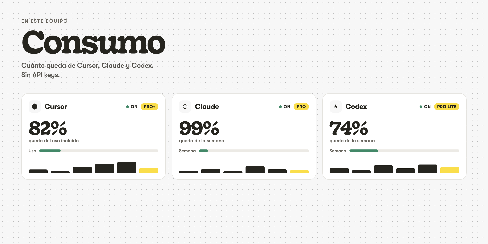

# Consumo



Panel local para ver cuánto queda de **Cursor**, **Claude** y **Codex** en el equipo donde lo abres.

No pide API keys. Lee la sesión que ya tienes abierta y consulta cada servicio desde tu máquina. Esta carpeta no guarda claves. El panel solo escucha en `127.0.0.1`: no se publica en internet.

Hace falta conexión para preguntar el consumo. Elegir una tipografía de Google Fonts también la usa. El resto de la pantalla vive en esta carpeta.

## Qué necesitas

1. [Node.js 22](https://nodejs.org) o más nuevo. No hace falta `npm install`: no hay dependencias.
2. Haber iniciado sesión en las apps que quieras ver.
3. macOS para Claude Desktop. Cursor y Codex también se leen en otros sistemas si la sesión está en el sitio habitual de cada app.

Comprueba Node antes de seguir:

```bash
node -v
```

Tiene que salir `v22` o superior. Si sale una versión más baja, o el comando no existe, instala Node desde https://nodejs.org y abre una terminal nueva.

## Bajarlo

Con Git:

```bash
git clone https://github.com/Raul-Marin/consumo.git
cd consumo
```

Sin Git: en GitHub pulsa **Code → Download ZIP**, descomprime la carpeta y ábrela en la terminal:

```bash
cd ruta/a/la/carpeta/consumo
```

## Arrancarlo

Desde esa carpeta:

```bash
node server.js
```

También vale `npm start`. Es el mismo comando.

En macOS se abre solo **http://127.0.0.1:3851**. En Windows o Linux copia la dirección que imprime la terminal y ábrela en el navegador.

Para arrancar sin abrir el navegador:

```bash
NO_OPEN=1 node server.js
```

La terminal tiene que seguir abierta. Para pararlo, vuelve a esa terminal y pulsa `Ctrl+C`.

## Primera vez

La pantalla pide qué suscripciones mirar. Marca solo las que uses: las demás no se consultan.

1. Revisa las que aparecen con sesión.
2. Quita las que no quieras.
3. Si marcas Claude y macOS pide acceso al llavero, pulsa **Permitir**. Solo lee la sesión de Claude en este equipo.
4. Entra al panel.

La elección se queda en este navegador, en este equipo. No viaja con la carpeta. En otro navegador, o en otro ordenador, se pregunta otra vez.

Si no aparece ninguna sesión, entra en la app y pulsa **Volver a mirar**.

## El panel

Cada programa es una tarjeta:

- El número grande es lo que queda del uso principal. En Cursor es el **uso incluido**, no la API. La API va en una barra aparte.
- **On** está recogiendo datos. **Off** está sin sesión o no se está consultando.
- La gráfica son los últimos seis meses. **Días** cambia a los últimos catorce. La barra de hoy, o la del mes actual, va en amarillo. Al pasar el cursor se ve el día y los tokens.
- **Modelos** y **Proyectos** se abren dentro de la tarjeta.
- Los seis puntos de la izquierda arrastran la tarjeta para cambiar el orden. El orden se recuerda en este navegador.
- **Actualizar** vuelve a preguntar ahora. Entre medias se refresca solo.

Arriba a la derecha:

- **theme.** Familia (Actual, Editorial, Sistema, Mono o una de Google Fonts), versión **light** / **dark**, colores y espacio (Compacto, Normal, Amplio, Extendido). **Volver al tema** restaura el aspecto original. El campo vacío de Google Fonts vuelve a la familia de ahora.
- **ajustes.** Avisos, cada cuánto se refresca, **Cambiar cuentas** y la nota de que las claves no se guardan aquí.

Abajo, el enlace **Shift+R 2026** sale a https://www.shiftr.pro. El panel no es un producto de esa web.

## Si una tarjeta no carga

- **Cursor.** Abre Cursor e inicia sesión. La sesión se lee de la base local de Cursor (`state.vscdb`), no de un token que tengas que pegar.
- **Claude.** Abre Claude Desktop e inicia sesión. Si usas Claude Code, también vale `~/.claude/.credentials.json` mientras no haya caducado. En Mac, Claude Desktop pide el llavero la primera vez: pulsa **Permitir**. En Windows y Linux esa sesión de escritorio no se lee; hace falta la de Claude Code.
- **Codex.** En la terminal, `codex login`. La sesión es `~/.codex/auth.json`. No se lee ni se muestra `OPENAI_API_KEY`.

Una tarjeta en Off no apaga las otras. Pulsa **Actualizar** después de entrar en la app. Si acabas de instalarla, **Cambiar cuentas** y luego **Volver a mirar**.

## Ajustes opcionales

Por defecto el puerto es `3851` y se refresca cada 30 segundos. No hace falta ningún archivo.

Si quieres cambiarlo, copia el ejemplo y edita solo lo que necesites:

```bash
cp config.example.json config.json
```

| Campo | Qué hace |
| --- | --- |
| `port` | Puerto local. Por defecto `3851`. |
| `refreshSeconds` | Cada cuánto se actualiza solo. Mínimo 15. |
| `tools` | Respaldo si alguien llama a la API sin elegir. En el navegador manda la pantalla inicial. |

`config.json` no se sube a Git. Cada persona tiene el suyo.

Otro puerto sin archivo:

```bash
PORT=3852 node server.js
```

Si `3851` ya está ocupado, usa otro puerto. No cierres el programa que lo esté usando.

## Comprobar que responde

Con el servidor en marcha, en otra terminal:

```bash
curl http://127.0.0.1:3851/api/health
```

Tiene que responder `{"ok":true}`.

## Actualizarlo

Dentro de la carpeta, con el servidor parado:

```bash
git pull
node server.js
```

Si lo bajaste en ZIP, descarga el ZIP nuevo y sustituye la carpeta. `config.json`, si lo creaste, cópialo a la carpeta nueva. La elección de cuentas y el tema siguen en el navegador.

## Qué se lee, y qué no

- Cursor: la sesión ya abierta en la app, y el uso de ese ciclo en cursor.com.
- Claude: la sesión de Claude Desktop (en Mac, con permiso del llavero) o la de Claude Code, y el uso de claude.ai o de la API de sesión.
- Codex: `~/.codex/auth.json` y el uso de la cuenta de ChatGPT. No la API key de OpenAI.
- En el navegador se guarda qué cuentas miras, en qué orden, y el tema. Solo en ese navegador.

No pegues tokens en esta carpeta. No hace falta `.env`.
